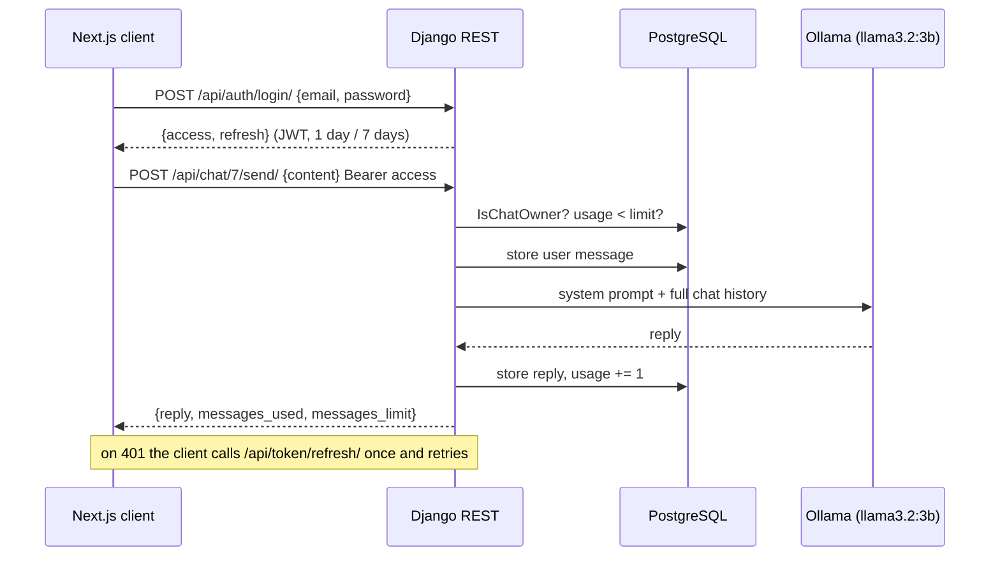

<div align="center">


# DassIt

A self-hosted chatbot: Django REST API with JWT auth and per-user message quotas, a Next.js chat client, and a local Llama 3.2 served by Ollama. Everything starts with one `docker compose up`.

**[Open the glass-box demo](https://liiiaamm.github.io/dassit/)** · [How it works](#how-it-works) · [Run it](#running-it) · [API](#api)


</div>

---

## The demo

GitHub Pages cannot run Django or a language model, so the [demo](https://liiiaamm.github.io/dassit/) is a glass box. It has the chat client on one side and, on the other, every HTTP request the client sends, along with the JSON that comes back. A small in-browser stand-in for the API follows the same rules as the Django views:
- registration checks match the serializer;
- tokens are signed JWTs that expire;
- chats return 403 unless they are yours;
- the backend refuses the 101st message of the month.

You can fast-forward the clock to watch an expired access token trigger the client’s silent refresh, or let the refresh token expire and get logged out. Building the demo surfaced a real bug. The submitted client stored the new access token after a refresh but kept the old refresh token, which the server had just blacklisted, so every user got logged out on the second day. `api.js` now keeps the rotated token, and the demo’s “as submitted” switch replays the old behaviour. The bot replies come from a scripted stand-in rather than Llama 3.2: the reply explains what the real backend would have done with your message.

## How it works



- **Auth.** Users log in with email and password and get a SimpleJWT pair. The access token lasts a day and the refresh token a week. Refresh tokens rotate, and the old ones are blacklisted, so logging out really ends the session.
- **Quotas.** Each account has a `Usage` row allowing 100 messages per 30 days. The send endpoint resets the counter once the window has passed and returns 403 when the limit is reached.
- **Ownership.** Every chat endpoint checks `IsChatOwner`, so guessing another chat’s id gets you a 403, not its messages.
- **The model.** `ai/llm_service.py` sends the whole conversation to Ollama with a short system prompt. Set `OLLAMA_MODEL` to change the model and `OLLAMA_MODELS` to choose which models get pulled on first start.
- **The client.** `frontend/src/lib/api.js` wraps `fetch`. It attaches the bearer token, refreshes once on a 401 and retries, and sends the user to `/login` if the refresh fails too.

## Running it

```bash
cp .env.example .env        # set POSTGRES_PASSWORD and DJANGO_SECRET_KEY
docker compose up -d
docker compose logs -f ollama-init   # first run downloads the model (about 2 GB)
```

| Service | URL |
|---------|-----|
| Chat client | http://localhost:3000 |
| API | http://localhost:8000 |
| Swagger docs | http://localhost:8000/api/docs |
| Django admin | http://localhost:8000/admin |
| Ollama | http://localhost:11434 |

To run the backend outside Docker with SQLite, use `backend/.env.example`, then `uv sync` and `python restApi/manage.py migrate && python restApi/manage.py runserver`. See [backend/README.md](backend/README.md).

## API

| Method | Path | What it does |
|--------|------|--------------|
| POST | `/api/auth/register/` | Create an account (username, email, password1, password2) and return a token pair |
| POST | `/api/auth/login/` | Email and password → `{access, refresh}` |
| POST | `/api/token/refresh/` | Rotate the refresh token and return a new access token |
| POST | `/api/auth/log-out/` | Blacklist the refresh token |
| GET, PATCH, DELETE | `/api/auth/profile/` | Read, edit or delete your account |
| POST | `/api/auth/change-password/` | Check the old password, validate and set the new one |
| GET, POST | `/api/chat/` | List your chats or create one |
| GET, DELETE | `/api/chat/<id>/` | One chat with its messages (owner only) |
| POST | `/api/chat/<id>/send/` | Send a message and get the model’s reply (owner only, counts against quota) |
| GET | `/api/chat/usage/` | `{messages_used, messages_limit, reset_date}` |

## Team

Built in spring 2026 at Comillas ICAI (BSc in Mathematical Engineering and AI) by **Sergio Fernández Cordero** ([@SergioFdz05](https://github.com/SergioFdz05)) and **Liam Esgueva** ([@liiiaamm](https://github.com/liiiaamm)).
